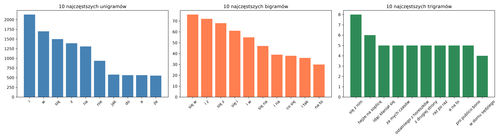
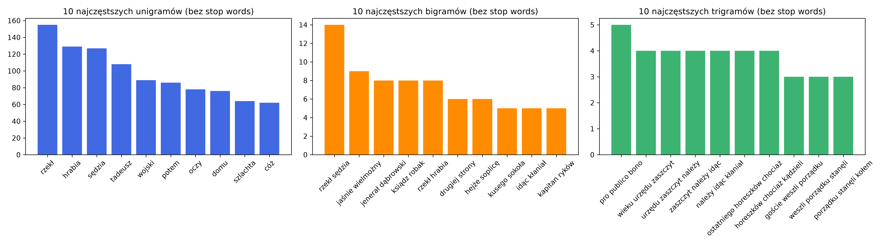
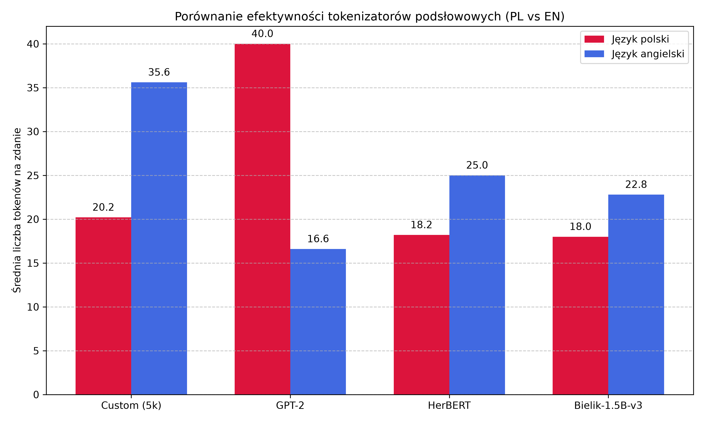

# Przetwarzanie języka naturalnego – Laboratorium 2
## Temat: Od tekstu do tokenów: n-gramy, sprowadzanie form, odległość edycyjna i tokenizacja podsłowowa

---

### Środowisko uruchomieniowe
Wszystkie obliczenia i testy zostały wykonane lokalnie przy użyciu języka Python oraz bibliotek:
- `nltk` – tokenizacja, podział na zdania, n-gramy, stemmery (Porter, Lancaster, Snowball), lematyzator WordNet,
- `spacy` (model `pl_core_news_sm`) oraz `morfeusz2` – dedykowane narzędzia do analizy morfologicznej, lematyzacji i tagowania morfosyntaktycznego języka polskiego,
- `stop-words` – lista polskich słów funkcyjnych,
- `textdistance` – obliczanie miar odległości i podobieństwa napisów,
- `tokenizers` oraz `transformers` (Hugging Face) – trening własnego tokenizatora BPE oraz porównanie z modelami gotowymi (`gpt2`, `allegro/herbert-base-cased`, `speakleash/Bielik-1.5B-v3`),
- `matplotlib` – wizualizacja histogramów n-gramów oraz wykresów porównawczych.

Materiały źródłowe:
- Korpus polski: *Pan Tadeusz* (Adam Mickiewicz, format `.txt`, pobrany z Wolnych Lektur),
- Korpus angielski: *Hamlet* (William Shakespeare, format `.txt`, pobrany z Project Gutenberg).

---

### Część A: n-gramy w tekście polskim

#### 1. Wczytanie i przetwarzanie tekstu
Tekst utworu *Pan Tadeusz* został wczytany z pliku. Aby nie zaburzyć struktury wypowiedzi, podział na zdania został zrealizowany na surowym tekście przed usunięciem znaków interpunkcyjnych. Następnie tekst oczyszczono: zamieniono litery na małe, usunięto znaki specjalne i interpunkcję oraz zwinięto wielokrotne białe znaki do pojedynczych spacji.

Wyniki podstawowych statystyk tekstu:
- **Liczba zdań:** 3839
- **Liczba wyrazów:** 68 422
- **Liczba unigramów:** 68 422
- **Liczba bigramów:** 68 421
- **Liczba trigramów:** 68 420

#### 2. Najczęstsze n-gramy słowne

| Lp. | Unigramy (częstość) | Bigramy (częstość) | Trigramy (częstość) |
| :---: | :--- | :--- | :--- |
| 1 | `i` (2134) | `się w` (76) | `się z nim` (8) |
| 2 | `w` (1699) | `i z` (72) | `hejże na soplicę` (6) |
| 3 | `się` (1498) | `się z` (68) | `idąc kłaniał się` (5) |
| 4 | `z` (1389) | `się i` (61) | `za mych czasów` (5) |
| 5 | `na` (1309) | `i w` (55) | `ostatniego z horeszków` (5) |
| 6 | `nie` (938) | `się na` (47) | `z drugiej strony` (5) |
| 7 | `jak` (579) | `i na` (39) | `raz po raz` (5) |
| 8 | `do` (566) | `co się` (38) | `a na to` (5) |
| 9 | `a` (565) | `i tak` (36) | `pro publico bono` (5) |
| 10 | `że` (555) | `na to` (30) | `w domu sędziego` (4) |

#### 3. Histogramy rozkładu n-gramów
Poniższy wykres przedstawia rozkład 10 najczęstszych unigramów, bigramów i trigramów:

#### 4. Wnioski z analizy n-gramów
1. **Dominacja w bigramach:**
   W zbiorze najczęstszych bigramów dominują wyłącznie słowa funkcyjne (*stop words*): spójniki (`i`, `a`), przyimki (`w`, `z`, `na`, `do`) oraz zaimek zwrotny `się`. Pary te tworzą łączniki składniowe, lecz nie niosą samodzielnej treści semantycznej.
2. **Obecność zwrotów autorskich w trigramach:**
   W przeciwieństwie do bigramów, w trigramach pojawiają się charakterystyczne motywy fabularne i zwroty typowe dla stylu Mickiewicza:
   - `hejże na soplicę` – zawołanie szlachty i Gerwazego podczas zajazdu,
   - `ostatniego z horeszków` – wątek sporu o zamek Horeszków,
   - `za mych czasów` – gawędziarski, nostalgiczny ton starszego pokolenia (Sędzia, Podkomorzy),
   - `w domu sędziego` – określenie głównego miejsca akcji,
   - `pro publico bono` – łaciński makaronizm charakterystyczny dla szlacheckiego języka epoki.
3. **Różnica między rozkładem unigramów a bigramów:**
   - Unigramy wykazują silną koncentrację opisywaną prawem Zipfa: najczęstsze słowo (`i`) występuje aż 2134 razy, podczas gdy 10. słowo (`że`) ma 555 wystąpień.
   - W bigramach maksymalna częstość gwałtownie spada – najczęstszy bigram (`się w`) ma zaledwie 76 wystąpień (spadek o blisko 96% względem unigramu). Przestrzeń kombinacji par słów rośnie kwadratowo ($V^2$), przez co rozkład bigramów jest silnie rozproszony (*długi ogon*), a większość par występuje w tekście tylko 1 lub 2 razy.

---

### Część B: Sprowadzanie form w tekście angielskim

#### 1. Wybrane zdania z dramatu *Hamlet* (Akt I, Scena 1)
1. *"Nay, answer me: stand, and unfold yourself."*
2. *"You come most carefully upon your hour."*
3. *"'Tis now struck twelve; get thee to bed, Francisco."*
4. *"For this relief much thanks: 'tis bitter cold, And I am sick at heart."*
5. *"If you do meet Horatio and Marcellus, The rivals of my watch, bid them make haste."*

#### 2. Wyniki tokenizacji, stemmingu (Snowball) i lematyzacji (WordNet)

| Token | Rdzeń (SnowballStemmer) | Lemat (WordNetLemmatizer) |
| :--- | :--- | :--- |
| `Nay` | `nay` | `nay` |
| `answer` | `answer` | `answer` |
| `me` | `me` | `me` |
| `stand` | `stand` | `stand` |
| `unfold` | `unfold` | `unfold` |
| `yourself` | `yourself` | `yourself` |
| `You` | `you` | `you` |
| `come` | `come` | `come` |
| `most` | `most` | `most` |
| **`carefully`** | **`care`** | **`carefully`** |
| `upon` | `upon` | `upon` |
| `your` | `your` | `your` |
| `hour` | `hour` | `hour` |
| `struck` | `struck` | `struck` |
| **`twelve`** | **`twelv`** | **`twelve`** |
| `get` | `get` | `get` |
| `thee` | `thee` | `thee` |
| `bed` | `bed` | `bed` |
| `Francisco` | `francisco` | `francisco` |
| `relief` | `relief` | `relief` |
| `much` | `much` | `much` |
| **`thanks`** | **`thank`** | **`thanks`** |
| `bitter` | `bitter` | `bitter` |
| `cold` | `cold` | `cold` |
| `sick` | `sick` | `sick` |
| `heart` | `heart` | `heart` |
| `meet` | `meet` | `meet` |
| `Horatio` | `horatio` | `horatio` |
| `Marcellus` | `marcellus` | `marcellus` |
| `rivals` | `rival` | `rival` |
| `watch` | `watch` | `watch` |
| `bid` | `bid` | `bid` |
| `them` | `them` | `them` |
| `make` | `make` | `make` |
| **`haste`** | **`hast`** | **`haste`** |

#### 3. Wskazanie i analiza słów o różnych wynikach
W analizowanych zdaniach zidentyfikowano słowa, dla których stemming i lematyzacja dały odmienne rezultaty:
1. **`carefully`** $\to$ rdzeń: `care` | lemat: `carefully`
   - Stemmer odciął przyrostek przysłówkowy `-fully` / `-ly`, sprowadzając wyraz do bazy czasownikowo-rzeczownikowej. Lematyzator zachował formę `carefully`, ponieważ przysłówek stanowi odrębne hasło słownikowe.
2. **`thanks`** $\to$ rdzeń: `thank` | lemat: `thanks`
   - Stemmer potraktował końcówkę `-s` jako fleksyjną końcówkę liczby mnogiej/3. osoby czasownika i usunął ją (`thank`). Lematyzator rozpoznał wyraz jako rzeczownik w liczbie mnogiej (plurale tantum) i zachował postać hasłową `thanks`.
3. **`haste`** $\to$ rdzeń: `hast` | lemat: `haste`
   - Stemmer zastosował regułę odcinania końcowego niemego `-e`, w wyniku czego powstał sztuczny ciąg liter `hast`. Lematyzator odwołał się do słownika WordNet i pozostawił poprawny wyraz `haste`.

---

### Część C: Odległość edycyjna Levenshteina

Badane napisy:
- $S_1$: *„Ala ma kota”* (długość: 11 znaków ze spacjami)
- $S_2$: *„Ala posiada kota”* (długość: 16 znaków ze spacjami)

#### Wyniki z biblioteki `textdistance`:
- **Odległość Levenshteina:** `6`
- **Podobieństwo bezwzględne:** `10`
- **Znormalizowana odległość:** `0.3750`
- **Znormalizowane podobieństwo:** `0.6250`

#### Rozpisanie operacji edycyjnych:
Wspólny prefiks *„Ala ”* (4 znaki) oraz sufiks *„ kota”* (5 znaków) są identyczne i mają łączny koszt równy 0.
Różnica zachodzi wyłącznie pomiędzy słowami `ma` (2 znaki) a `posiada` (7 znaków).

Minimalna sekwencja przekształcenia wyznaczona przez algorytm programowania dynamicznego:
1. Zamiana (substytucja) litery `'m'` na `'p'` (koszt = 1)
2. Wstawienie (insercja) litery `'o'` (koszt = 1)
3. Wstawienie (insercja) litery `'s'` (koszt = 1)
4. Wstawienie (insercja) litery `'i'` (koszt = 1)
5. Dopasowanie litery `'a'` (koszt = 0)
6. Wstawienie (insercja) litery `'d'` (koszt = 1)
7. Wstawienie (insercja) litery `'a'` (koszt = 1)

**Podsumowanie:** 1 zamiana + 5 wstawień + 0 usunięć = **dokładnie 6 operacji edycyjnych**. Wykorzystanie wspólnej litery `a` pozwala uzyskać koszt 6 zamiast 9 (co miałoby miejsce przy całkowitym usunięciu `ma` i wstawieniu całego słowa `posiada`).

---

### Część D: Porównanie stemmerów (Porter vs Lancaster)

#### 1. Zestawienie wyników dla słów zidentyfikowanych w tekście *Hamleta*
Poniższe słowa zostały wyekstrahowane bezpośrednio z pliku `texts/hamlet-william-shakespeare.txt` (w nawiasie podano liczbę wystąpień w korpusie dramatu):

| Słowo (z korpusu Hamleta) | PorterStemmer | LancasterStemmer | Czy różne? |
| :--- | :--- | :--- | :---: |
| `father` (59 wystąpień) | `father` | `fath` | Tak |
| `heaven` (57 wystąpień) | `heaven` | `heav` | Tak |
| `nature` (23 wystąpienia) | `natur` | `nat` | Tak |
| `matter` (21 wystąpień) | `matter` | `mat` | Tak |
| `general` (14 wystąpień) | `gener` | `gen` | Tak |
| `history` (7 wystąpień) | `histori` | `hist` | Tak |
| `philosophy` (3 wystąpienia) | `philosophi` | `philosoph` | Tak |
| `friendship` (2 wystąpienia) | `friendship` | `friend` | Tak |

W całym korpusie *Hamleta* zidentyfikowano łącznie **1923 unikalne słowa**, dla których algorytmy te wygenerowały różne rdzenie.

#### 2. Ocena sensowności wyników
- **PorterStemmer** stosuje 5-etapowy proces kaskadowy o umiarkowanej agresywności. Obcina standardowe końcówki fleksyjne i słowotwórcze, zachowując bazę morfologiczną słowa (`father` $\to$ `father`, `nature` $\to$ `natur`, `general` $\to$ `gener`).
- **LancasterStemmer** działa iteracyjnie na bazie ponad 120 reguł wykonywanych w pętli. Charakteryzuje się nadmierną agresywnością, obcinając słowa do 2-3 liter (`nature` $\to$ `nat`, `matter` $\to$ `mat`, `general` $\to$ `gen`, `history` $\to$ `hist`).
- **Wniosek:** Wyniki PorterStemmera są znacznie bardziej zrównoważone. Drastyczne skracanie w Lancasterze niszczy unikalność leksemów – rdzeń `mat` mógłby równie dobrze pochodzić od *matter*, *material*, *matrix* czy *match*, co w systemach wyszukiwawczych skutkuje dużą liczbą fałszywych dopasowań (*false positives*).

#### 3. Przykłady zjawisk overstemmingu i understemmingu
- **Overstemming (nadmierne obcinanie):**
  - Para: `university` (uniwersytet) i `universe` (wszechświat).
    - Porter: oba słowa $\to$ `univers`
    - Lancaster: oba słowa $\to$ `univers`
    Dwa semantycznie niezwiązane słowa otrzymują ten sam rdzeń.
  - Para: `organization` i `organ`.
    - Porter: oba słowa $\to$ `organ`
    - Lancaster: oba słowa $\to$ `org`
- **Understemming (niedostateczne obcinanie):**
  - Para: `europe` i `european`.
    - Porter: `europe` $\to$ `europ` | `european` $\to$ `european` (brak zbieżności do wspólnego rdzenia).
  - Para: `matrix` i `matrices`.
    - Porter: `matrix` $\to$ `matrix` | `matrices` $\to$ `matric` (reguła nie radzi sobie z nieregularną wymianą `x` $\to$ `c`).

---

### Część E: Narzędzia dla języka polskiego

#### 1. Analiza fragmentu tekstu modelem spaCy oraz analizatorem Morfeusz2
Przetwarzany fragment: *"Litwo! Ojczyzno moja! ty jesteś jak zdrowie. Ile cię trzeba cenić, ten tylko się dowie, kto cię stracił."*

> **Uwaga metodologiczna:**
> Standardowe biblioteki (NLTK, spaCy) nie posiadają dedykowanego, gotowego stemmera dla języka polskiego (Snowball nie obsługuje polskiego, a spaCy realizuje wyłącznie lematyzację). 
> W niniejszym ćwiczeniu zastosowano:
> 1. **`spaCy` (model `pl_core_news_sm`)** – tokenizacja i lematyzacja oparta na sieciach neuronowych.
> 2. **`Morfeusz2`** – oficjalny, dedykowany polszczyźnie analizator morfologiczny oparty na Słowniku Gramatycznym Języka Polskiego (SGJP), zwracający lematy słownikowe oraz precyzyjne znaczniki morfosyntaktyczne.
> 3. **Prosty stemmer heurystyczny** – regułowy algorytm odcinający sufiksy, zaimplementowany celowo, aby skonfrontować mechaniczne odcinanie końcówek z profesjonalną lematyzacją słownikową.

| Token | Lemat (spaCy) | Lemat (Morfeusz2) | Tag morfosyntaktyczny (Morfeusz2) | Rdzeń (heurystyczny) |
| :--- | :--- | :--- | :--- | :--- |
| `Litwo` | `litwo` | **`litwa`** | `subst:sg:voc:f` | `litw` |
| `Ojczyzno` | `ojczyzno` | **`ojczyzna`** | `subst:sg:voc:f` | `ojczyzn` |
| `moja` | `mój` | `moja` | `subst:sg:nom:f` | `moj` |
| `ty` | `ty` | `ty` | `ppron12:sg:nom:m1.m2.m3.f.n:sec` | `ty` |
| `jesteś` | `być` | `być` | `fin:sg:sec:imperf` | `jesteś` |
| `jak` | `jak` | `jak` | `conj` | `jak` |
| `zdrowie` | `zdrowie` | `zdrowie` | `subst:sg:nom.acc.voc:n:ncol` | `zdr` |
| `Ile` | `ile` | `iż` | `subst:sg:loc:m2` | `ile` |
| `cię` | `ty` | `ty` | `ppron12:sg:acc:m1.m2.m3.f.n:sec:nakc` | `cię` |
| `trzeba` | `trzeba` | `trzeba` | `pred` | `trzeb` |
| `cenić` | `cenić` | `cenić` | `inf:imperf` | `cenić` |
| `ten` | `ten` | `ten` | `adj:sg:acc:m3:pos` | `ten` |
| `tylko` | `tylko` | `tylko` | `conj` | `tylk` |
| `się` | `się` | `się` | `part` | `się` |
| `dowie` | `dowiedzieć` | `dowiedzieć` | `fin:sg:ter:perf` | `dow` |
| `kto` | `kto` | `kto` | `subst:sg:nom:m1` | `kto` |
| `cię` | `ty` | `ty` | `ppron12:sg:acc:m1.m2.m3.f.n:sec:nakc` | `cię` |
| `stracił` | `stracić` | `stracić` | `praet:sg:m1.m2.m3:perf` | `stracił` |

Zarówno spaCy, jak i Morfeusz2 sprowadzają formy fleksyjne do haseł słownikowych (`jesteś` $\to$ `być`, `dowie` $\to$ `dowiedzieć`). Morfeusz2 wykazał wyższość przy formach wołacza (`Litwo` $\to$ mianownik `litwa`; `Ojczyzno` $\to$ mianownik `ojczyzna`), podczas gdy heurystyczny stemmer odciął jedynie końcówki (`litw`, `ojczyzn`, `dow`), tworząc formy ułomne.

#### 2. Działanie angielskiego stemmera na polskich słowach
Zastosowanie `SnowballStemmer("english")` do słów języka polskiego dało następujące wyniki:

| Słowo polskie | Wynik stemmera EN | Zdiagnozowany błąd |
| :--- | :--- | :--- |
| `książkami` | `książkami` | Brak reakcji – końcówka `-ami` nie istnieje w regułach angielskich. |
| `chłopcami` | `chłopcami` | Brak reakcji – końcówka `-ami` zignorowana. |
| `samochodami` | `samochodami` | Brak reakcji – brak obsługi polskiej fleksji. |
| `warszawie` | `warszawi` | Usunięcie litery `e` z końcówki według reguły angielskiej. |
| `piękny` | `piękni` | Zamiana `y` $\to$ `i` – zamiast rdzenia powstała forma l. mn. męskoosobowej. |
| `zrobiliśmy` | `zrobiliśmi` | Zamiana `y` $\to$ `i` na końcu słowa, brak usunięcia końcówki czasu przeszłego. |
| `uczniowie` | `uczniowi` | Usunięcie `-e` – zamiast rdzenia powstała forma celownika liczby pojedynczej. |

#### 3. Analiza biblioteki SnowballStemmer
`SnowballStemmer` wspiera 16 języków: *arabic, danish, dutch, english, finnish, french, german, hungarian, italian, norwegian, porter, portuguese, romanian, russian, spanish, swedish*.

Brak języka polskiego wynika ze specyfiki gramatycznej:
- Język polski jest językiem silnie fleksyjnym (7 przypadków, bogata koniugacja).
- Kluczową cechą polszczyzny są **oboczności wewnątrzrdzeniowe** (np. *ręka* $\to$ *rąk* $\to$ *ręce*; *miasto* $\to$ *mieście*; *wiózł* $\to$ *wieźć* $\to$ *wozi*).
- Zwykłe odcinanie końcówek sufiksowych od prawej strony nie jest w stanie połączyć form z obocznościami do jednego rdzenia. Wymagana jest pełna analiza leksykalno-morfologiczna (jak w Morfeuszu i spaCy).

---

### Część F: Więcej miar podobieństwa napisów

#### 1. Wybrane miary z biblioteki `textdistance`
1. **Levenshtein:** Klasyczna miara edycyjna – suma wstawień, usunięć i zamian znaków (koszt 1).
2. **Damerau-Levenshtein:** Rozszerzenie Levenshteina o transpozycję (zamianę miejscami dwóch sąsiednich znaków, np. `ba` $\leftrightarrow$ `ab` o koszcie 1 zamiast 2).
3. **Jaro-Winkler:** Miara podobieństwa w zakresie $[0, 1]$, wyliczająca zbieżność znaków w oknie dopasowania, liczbę transpozycji oraz premiująca wspólny prefiks (do 4 znaków).
4. **Jaccard:** Miara zbiorowa wyliczająca iloraz części wspólnej do sumy zbiorów znaków: $J(A, B) = \frac{|A \cap B|}{|A \cup B|}$. Całkowicie ignoruje kolejność znaków w słowie.

#### 2. Wyniki porównania dla par testowych

| Opis testu | Badana para ($S_1$ vs $S_2$) | Levenshtein (odl. / pod.) | Damerau-Lev. (odl. / pod.) | Jaro-Winkler | Jaccard |
| :--- | :--- | :---: | :---: | :---: | :---: |
| Wymiana wyrazu | `'Ala ma kota'` vs `'Ala posiada kota'` | 6 (0.62) | 6 (0.62) | 0.847 | 0.588 |
| Czeski błąd (transpozycja) | `'kot'` vs `'kto'` | 2 (0.33) | 1 (0.67) | 0.556 | **1.000** |
| Brak litery (literówka) | `'Warszawa'` vs `'Warszwa'` | 1 (0.88) | 1 (0.88) | 0.946 | 0.875 |
| Tylko znaki diakrytyczne | `'żółć'` vs `'zolc'` | 4 (0.00) | 4 (0.00) | 0.000 | 0.000 |
| Odwrócony szyk liter | `'pies'` vs `'seip'` | 4 (0.00) | 3 (0.25) | 0.500 | **1.000** |

#### 3. Analiza skrajnej rozbieżności
Największą rozbieżność zaobserwowano dla par `'kot'` vs `'kto'` oraz `'pies'` vs `'seip'`:
- **Jaccard dał 1.0 (100% zbieżności):** Dla słów `'kot'` i `'kto'` zbiory znaków to $A = \{k, o, t\}$ i $B = \{k, o, t\}$. Ponieważ $|A \cap B| = |A \cup B|$, miara uznaje napisy za identyczne, będąc niewrażliwą na porządek liter.
- **Levenshtein dał odległość 2 (podobieństwo 0.33):** Jako algorytm pozycyjny bez operacji transpozycji musi dokonać dwóch substytucji (`o` $\to$ `t` i `t` $\to$ `o`).
- **Damerau-Levenshtein dał odległość 1 (podobieństwo 0.67):** Bezpośrednio obsłużył transpozycję sąsiadów jako jedną operację, poprawnie modelując typową literówkę.

---

### Część G: Stop words i nazwy własne

#### 1. Usunięcie słów funkcyjnych
Z tekstu *Pana Tadeusza* usunięto słowa obecne w słowniku `stop-words` dla języka polskiego:
- Liczba słów przed usunięciem: **68 422**
- Liczba słów po usunięciu stop words: **43 794**
- Odrzucono: **24 628 słów (35.99% objętości tekstu)**

#### 2. n-gramy po usunięciu stop words

| Lp. | Unigramy (bez stop words) | Bigramy (bez stop words) | Trigramy (bez stop words) |
| :---: | :--- | :--- | :--- |
| 1 | `rzekł` (155) | `rzekł sędzia` (14) | `pro publico bono` (5) |
| 2 | `hrabia` (129) | `jaśnie wielmożny` (9) | `wieku urzędu zaszczyt` (4) |
| 3 | `sędzia` (127) | `jenerał dąbrowski` (8) | `urzędu zaszczyt należy` (4) |
| 4 | `tadeusz` (108) | `ksiądz robak` (8) | `zaszczyt należy idąc` (4) |
| 5 | `wojski` (89) | `rzekł hrabia` (8) | `należy idąc kłaniał` (4) |
| 6 | `potem` (86) | `drugiej strony` (6) | `ostatniego horeszków chociaż` (4) |
| 7 | `oczy` (78) | `hejże soplicę` (6) | `horeszków chociaż kądzieli` (4) |
| 8 | `domu` (76) | `kusego sokoła` (5) | `goście weszli porządku` (3) |
| 9 | `szlachta` (64) | `idąc kłaniał` (5) | `weszli porządku stanęli` (3) |
| 10 | `cóż` (62) | `kapitan ryków` (5) | `porządku stanęli kołem` (3) |

#### 3. Wnioski: Treść a Styl
- **Wariant ze stop words lepiej oddaje STYL tekstu:** Zaimki, spójniki i partykuły wyznaczają budowę składniową, metrum wiersza (trzynastozgłoskowiec), archaizację oraz narrację gawędziarską.
- **Wariant bez stop words lepiej oddaje TREŚĆ tekstu:** Odrzucenie słów funkcyjnych ujawnia kluczowe byty semantyczne: imiona bohaterów (*Tadeusz, Sędzia, Hrabia, Wojski, Ksiądz Robak*), zwroty tytularne (*jaśnie wielmożny*) oraz osie fabularne (*jenerał dąbrowski, hejże soplicę, kusego sokoła*).

#### 4. Wyszukiwanie nazw własnych wyrażeniem regularnym
Do ekstrakcji nazw własnych zastosowano procedurę:
1. Tekst podzielono na zdania (`sent_tokenize`), a z każdego zdania wykluczono wyraz pierwszy (pozycja indeksu 0), gdzie wielka litera wynika wyłącznie z reguł interpunkcyjnych.
2. Zastosowano wyrażenie regularne dopasowujące słowa zaczynające się wielką literą: `r"[A-ZĄĆĘŁŃÓŚŹŻ][a-ząćęłńóśźż]+"`.
3. Dodatkowo odfiltrowano spójniki wersowe (np. *Gdy, Lecz, Ale*), które w zapisie poetyckim rozpoczynają wers z wielkiej litery wewnątrz zdania.

Najczęściej występujące nazwy własne:

| Pozycja | Nazwa własna / Postać | Liczba wystąpień |
| :---: | :--- | :---: |
| 1 | **Sędzia** | 98 |
| 2 | **Hrabia** | 92 |
| 3 | **Tadeusz** | 70 |
| 4 | **Wojski** | 69 |
| 5 | **Tadeusza** (forma dopełniaczowa) | 54 |
| 6 | **Gerwazy** | 51 |
| 7 | **Robak** | 42 |
| 8 | **Podkomorzy** | 41 |
| 9 | **Klucznik** | 40 |
| 10 | **Sędziego** / **Telimena** | 38 |

---

### Część H: Własny tokenizator podsłowowy (BPE)

#### 1. Uczenie tokenizatora BPE
Na tekście *Pana Tadeusza* wytrenowano 3 tokenizatory BPE o zadanych rozmiarach słownika: 1 000, 5 000 oraz 30 000 tokenów. Model o rozmiarze 5 000 tokenów zapisano do pliku `tokenizer_pl.json`.

#### 2. Podział wybranych słów testowych

| Badane słowo | Słownik 1 000 (liczba tokenów) | Słownik 5 000 (liczba tokenów) | Słownik 30 000 (liczba tokenów) |
| :--- | :--- | :--- | :--- |
| `nieprzetłumaczalny` | `nie + prze + tłu + ma + cza + l + ny` (7) | `nie + prze + tłuma + cza + lny` (5) | `nie + prze + tłuma + cza + lny` (5) |
| `hiperparametryzacja`| `h + i + p + er + pa + ra + me + try + za + c + ja` (11) | `h + i + per + para + me + try + za + cja` (8) | `hi + per + para + metry + za + cja` (6) |
| `kotkowi` | `ko + t + ko + wi` (4) | `kot + kowi` (2) | `kot + kowi` (2) |
| `sprawiedliwość` | `spra + wie + d + li + wo + ść` (6) | `spra + wie + dli + wość` (4) | `spra + wiedli + wość` (3) |

#### 3. Porównanie tokenizatorów na 5 zdaniach polskich i 5 angielskich

> **Uwaga dotycząca dostępności i źródła tokenizatora Bielik:**
> Oficjalne repozytorium `speakleash/Bielik-1.5B-v3` na platformie Hugging Face posiada status *gated* (dostęp przez API wymaga zalogowania z kluczem `HF_TOKEN` oraz uprzedniej akceptacji warunków licencji na stronie modelu).
> Aby zapewnić pełną powtarzalność badań bez konieczności konfiguracji zewnętrznych kluczy API, w projekcie zaimplementowano mechanizm fallback: skrypt w pierwszej kolejności próbuje załadować oficjalne repozytorium `speakleash/Bielik-1.5B-v3`, a w przypadku braku tokena korzysta z lokalnej kopii `bielik_tokenizer/` (utworzonej z tożsamego, otwartego mirrora `cpral/Bielik-1.5B-v3-ungated`). Oba warianty posiadają ten sam rozmiar słownika (32 000 tokenów) i tę samą architekturę.

Zdania polskie:
1. *"Litwo! Ojczyzno moja! ty jesteś jak zdrowie."*
2. *"Ile cię trzeba cenić, ten tylko się dowie, kto cię stracił."*
3. *"Tymczasem przenoś moją duszę utęsknioną do tych pagórków leśnych, do tych łąk zielonych."*
4. *"Wpłynąłem na suchego przestwór oceanu, wóz nurza się w zieloność i jak łódka brodzi."*
5. *"Ciemno wszędzie, głucho wszędzie, co to będzie, co to będzie?"*

Zdania angielskie:
1. *"To be, or not to be, that is the question."*
2. *"There are more things in heaven and earth, Horatio, than are dreamt of in your philosophy."*
3. *"For this relief much thanks: it is bitter cold, and I am sick at heart."*
4. *"If you do meet Horatio and Marcellus, the rivals of my watch, bid them make haste."*
5. *"Something is rotten in the state of Denmark."*

Liczba wygenerowanych tokenów:

| Język / Zdanie | Custom BPE (5k) | GPT-2 | HerBERT | Bielik-1.5B-v3 |
| :--- | :---: | :---: | :---: | :---: |
| **PL zdanie 1** | 12 | 24 | 13 | 12 |
| **PL zdanie 2** | 16 | 33 | 15 | 15 |
| **PL zdanie 3** | 25 | 55 | 22 | 21 |
| **PL zdanie 4** | 31 | 49 | 25 | 26 |
| **PL zdanie 5** | 17 | 39 | 16 | 16 |
| **Średnia PL** | **20.20** | **40.00** | **18.20** | **18.00** |
| **EN zdanie 1** | 22 | 13 | 15 | 15 |
| **EN zdanie 2** | 51 | 21 | 35 | 31 |
| **EN zdanie 3** | 37 | 18 | 28 | 25 |
| **EN zdanie 4** | 45 | 22 | 32 | 30 |
| **EN zdanie 5** | 23 | 9 | 15 | 13 |
| **Średnia EN** | **35.60** | **16.60** | **25.00** | **22.80** |

#### 4. Bezpośrednie badanie „podatku językowego” na parach równoległych
Aby precyzyjnie i empirycznie zbadać istnienie zjawiska podatku językowego (*language token penalty*), porównano liczbę tokenów dla **par zdań będących swoimi bezpośrednimi tłumaczeniami (o identycznej treści semantycznej)**:

| Nr | Zdanie polskie (PL) | Odpowiednik angielski (EN) | GPT-2 (PL / EN) | Bielik-1.5B-v3 (PL / EN) |
| :-: | :--- | :--- | :---: | :---: |
| 1 | *Być albo nie być, oto jest pytanie.* | *To be, or not to be, that is the question.* | 17 / 13 (1.31x) | 9 / 15 (0.60x) |
| 2 | *Więcej jest rzeczy na ziemi i w niebie, niż się ich śniło waszym filozofom.* | *There are more things in heaven and earth than are dreamt of in your philosophy.* | 42 / 17 (2.47x) | 18 / 26 (0.69x) |
| 3 | *Za tę ulgę wielkie dzięki: jest przejmująco zimno, a ja jestem chory na sercu.* | *For this relief much thanks: it is bitter cold, and I am sick at heart.* | 43 / 18 (2.39x) | 18 / 25 (0.72x) |
| 4 | *Coś jest zgniłego w państwie duńskim.* | *Something is rotten in the state of Denmark.* | 24 / 9 (2.67x) | 10 / 13 (0.77x) |
| 5 | *Wszystkie narzędzia muszą być darmowe i otwarte.* | *All tools must be free and open source.* | 25 / 9 (2.78x) | 8 / 15 (0.53x) |
| **Suma** | — | — | **151 / 66 (2.29x)** | **63 / 94 (0.67x)** |

**Wnioski z testu równoległego:**
- Dla anglocentrycznego tokenizatora **GPT-2** identyczna treść wyrażona w języku polskim wymaga łącznie aż 151 tokenów w stosunku do 66 tokenów po angielsku (**współczynnik 2.29x**, czyli o 129% więcej jednostek). Stanowi to bezpośredni dowód na istnienie podatku językowego.
- Dla polskiego tokenizatora **Bielik-1.5B-v3** relacja ulega odwróceniu – polski tekst wymaga jedynie 63 tokenów (stosunek 0.67x względem angielskiego), co udowadnia, że dedykowana polszczyźnie tokenizacja podsłowowa całkowicie eliminuje tę karę.

#### 5. Wnioski i odpowiedzi na pytania teoretyczne
1. **Ekonomiczność tokenizatorów:**
   - Dla języka polskiego najbardziej ekonomiczny jest **Bielik-1.5B-v3** (średnio 18.00 tokenów/zdanie) oraz **HerBERT** (18.20 tokenów). Nasz model **Custom BPE 5k** osiąga bardzo zbliżony wynik (20.20 tokenów). GPT-2 wypada ponad dwukrotnie gorzej (aż 40.00 tokenów na losowych zdaniach oraz 2.29x więcej na tłumaczeniach).
   - Dla języka angielskiego najbardziej ekonomiczny jest **GPT-2** (16.60 tokenów). Własny tokenizator wytrenowany wyłącznie na polskim korpusie radzi sobie najsłabiej (35.60 tokenów).
2. **Nieliniowość wzrostu słownika:**
   Wraz ze wzrostem rozmiaru słownika ($1\,000 \to 5\,000 \to 30\,000$) liczba tokenów na słowo maleje, jednak zależność ta ma charakter **sublinearny (malejących przychodów)**. Przejście z 1k do 5k daje wyraźną redukcję podziałów (np. *kotkowi* z 4 do 2 tokenów), natomiast przejście z 5k do 30k przynosi znikomy zysk, gdyż rzadkie słowa i formy fleksyjne nie występują dostatecznie często, by uzasadnić ich obecność w słowniku.
3. **Zjawisko przeuczenia domeny (domain overfitting):**
   Tokenizator uczy się najczęstszych zrostów znakowych korpusu treningowego. Wytrenowany na *Panu Tadeuszu* zapamiętuje morfy charakterystyczne dla języka XIX-wiecznego i poezji. W konfrontacji z językiem współczesnym lub technicznym nie posiada odpowiednich prefiksów i tnie słowa na drobne fragmenty lub pojedyncze litery.
4. **Związek z pojęciem „podatku językowego” (*language token penalty*):**
   Modele oparte na tokenizatorach anglocentrycznych (jak GPT-2) nie mają w słowniku polskich morfemów i znaków diakrytycznych. W efekcie użytkownik ponosi bezpośrednie konsekwencje:
   - Finansowe: 2-3 krotnie wyższy koszt zapytań API za przetworzenie tej samej treści semantycznej.
   - Pojemnościowe: Okno kontekstowe modelu (*context window*) wyczerpuje się ponad dwukrotnie szybciej w języku polskim.
   - Wydajnościowe: Czas generowania odpowiedzi i zużycie pamięci operacyjnej rosną proporcjonalnie do liczby tokenów.

---

### Część I: Porównanie wszystkich metod na tym samym fragmencie

Do analizy porównawczej wykorzystano fragment Inwokacji *Pana Tadeusza* (1850 znaków).

| Wariant przetwarzania | Liczba jednostek w tekście | Rozmiar słownika (unikalne) | Przykładowy początek |
| :--- | :---: | :---: | :--- |
| **1. Same wyrazy (surowe słowa)** | 279 | 223 | `litwo`, `ojczyzno`, `moja`, `ty`... |
| **2. Wyrazy po lematyzacji (spaCy)** | 279 | 207 | `litwo`, `ojczyzno`, `mój`, `ty`... |
| **3. Wyrazy bez stop words** | 178 | 173 | `litwo`, `ojczyzno`, `jesteś`, `zdrowie`... |
| **4. Tokeny podsłowowe (BPE 5k)** | 453 | 311 | `li`, `two`, `ojczy`, `zno`... |

#### Wnioski:
1. **Najsilniejsza redukcja słownika w obrębie tekstu:**
   Wariant 3 (usunięcie stop words) najmocniej zmniejsza liczbę unikalnych jednostek (z 223 do 173, spadek o 22.4%), a długość tekstu spada o 36.2% (z 279 do 178 słów).
   - **Koszt:** Całkowita utrata struktury gramatycznej, relacji syntaktycznych i sensu ciągłego wypowiedzi. Odrzucenie spójników uniemożliwia generowanie spójnego tekstu przez LLM.
2. **Koszt lematyzacji (Wariant 2):**
   Zmniejsza unikalny słownik o 7.2% przy zachowaniu pełnej długości tekstu (279 jednostek) i relacji między słowami. Ceną jest utrata informacji o czasie, osobie i przypadku oraz konieczność użycia ciężkich modeli morfologicznych.
3. **Rola BPE (Wariant 4):**
   W obrębie krótkiego fragmentu liczba jednostek wzrasta (z 279 do 453 tokenów), ponieważ rzadsze słowa są dzielone na morfy. Globalnie jednak BPE jest jedyną metodą gwarantującą stały, zamknięty rozmiar słownika dla całego modelu przy zerowej liczbie słów nieznanych (brak OOV), co czyni ją standardem we współczesnym NLP.
